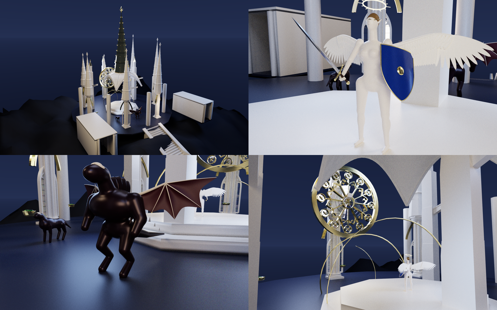

# Systems Architecture & Research Showcase — Hüseyin Efe Yener

**Preferred Name:** Misty  
**GitHub:** [github.com/efeyener0](https://github.com/efeyener0)

This repository provides architectural specifications, mathematical summaries, sample domain-specific language (DSL) programs, and GPU-rendered portfolio artifacts for large-scale or proprietary systems and ongoing theoretical revisions whose primary development repositories remain private.

---

## Architecture & Research Index

| Project / Domain | Primary Focus | Documentation & Artifacts | Source Repository Status |
| :--- | :--- | :--- | :--- |
| **[Atelier V (`atelier 5.0`, `.a5`)](atelier-v/README.md)** | Deterministic parallel 3D solid modeling DSL, content-addressed **SHA-256 Binary Merkle DAG** compiler, multi-method CSG spectrum, and **CUDA GPU path-tracer (`ffrt_lumiere`)** | [Architecture Deep-Dive](atelier-v/README.md) · [256-SPP CUDA Renders](atelier-v/renders/) · [370-Line `.a5` Scene Script](atelier-v/samples/museum_of_seven_heavens_kailash.a5) | Private Engine Repo *(Architecture, `.a5` script & renders published here)* |
| **[The Meridian, Biophysical Anatomy (`.anth`/`.antsc`), Fight World & Lyric (`.lyr`)](the-meridian-and-anatomy/README.md)** | Unified 5-layer C++20 engine monorepo, log-space allometric & isochoric muscle anatomy solver (`meridian::anat` v2), 106-segment combat rig (`canon-core`), and zero-dependency spectral music synthesizer (`Lyric 1.0`) | [5-Layer DAG & Domain Specifications](the-meridian-and-anatomy/README.md) | Private Monorepo *(Full architectural blueprint & domain contracts published here)* |
| **[Omni-Workbench & Omni-Toolkit](omni-ecosystem/README.md)** | Long-horizon 2-tier multi-agent orchestration, static-prefix prompt routing (`61%` context reduction via `--diet`), disjoint file-ownership locks (`--owns`), SQLite FTS5 (`BM25`) memory, and remote Google Colab GPU sandbox bridge | [Multi-Agent System Architecture](omni-ecosystem/README.md) | Private Repo *(Read-only GitFront link & architecture spec available)* |
| **[$E$-Theory: 12D Klein-Graded Non-Associative Projection Algebras](e-theory/README.md)** | Exact $(9,3)$-signature three-time extension of the non-associative algebra $\mathcal{A}=\operatorname{span}_{\mathbb{R}}\{1,h,q\}$ and $\mathfrak{so}(2,1)$ Lie holonomy | [Invariant Algebraic Core & v2 Revision Notice](e-theory/README.md) | Private Working Repo *(Undergoing major v2 theoretical revision; available upon request once finalized)* |
| **[Optimized TFT & Cold-Start Inference Infrastructure](https://github.com/efeyener0/Optimized-tft-model-and-cold-inference-system-for-financial-time-series)** | Decoupled `train/` vs. `core/` Temporal Fusion Transformer runtime, deterministic artifact packager, and zero-leakage cold-start inference orchestrator | [Public GitHub Repository](https://github.com/efeyener0/Optimized-tft-model-and-cold-inference-system-for-financial-time-series) | **Public** |
| **[3D Non-Associative Algebra & CUDA Wave-Topology Simulator](https://github.com/efeyener0/Some-fun-with-mathematics)** | Custom CUDA C++ kernels (`__constant__` memory, hardware intrinsics) evaluating $24.5\text{M}$ wave operations in $\sim 30\text{ ms}$ (`3.08M`-point 3D interference manifolds) | [Public GitHub Repository](https://github.com/efeyener0/Some-fun-with-mathematics) | **Public** |
| **[Spectral Operator & Non-Commutative Hilbert Space Ledger (`RH-GHM-NCHG`)](https://github.com/efeyener0/RH-proof-attempts)** | Operator-theoretic and spectral closure investigations | [Public GitHub Repository](https://github.com/efeyener0/RH-proof-attempts) | **Public** |

*(Note: **CM-CCBT**—Constrained-Manifold & Parallel Angular Verifier Transformer in native C++17/CUDA—is shared via a dedicated read-only **GitFront** inspection link on the CV to preserve private repository status.)*

---

## Featured Visual Artifact: *Atelier V (`atelier 5.0`)*

Generated 100% procedurally from a single **370-line `.a5` functional pipeline script** ([`atelier-v/samples/museum_of_seven_heavens_kailash.a5`](atelier-v/samples/museum_of_seven_heavens_kailash.a5)) spanning **11 domain libraries**, compiled into a **139-node SHA-256 Binary Merkle DAG** (`max_depth = 3`), producing **271 meshes (`486,613` vertices, `798,372` triangles, `19` PBR materials)** and rendered with the integrated **CUDA GPU path-tracer (`ffrt_lumiere`, 256 SPP, ACES Filmic tone mapping)**:

