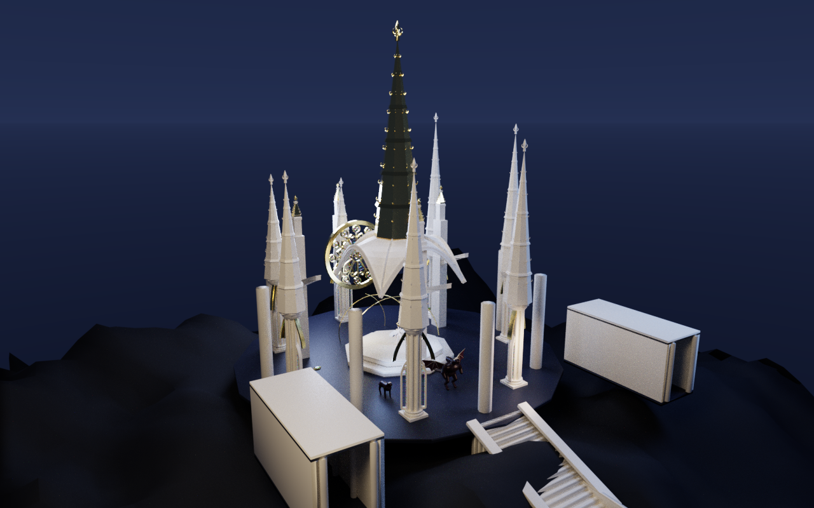
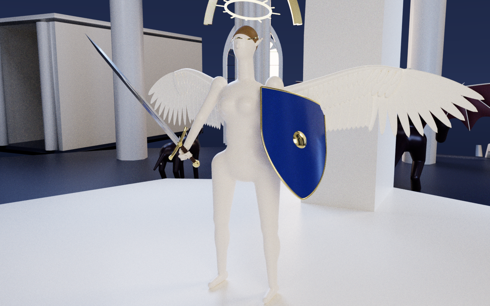
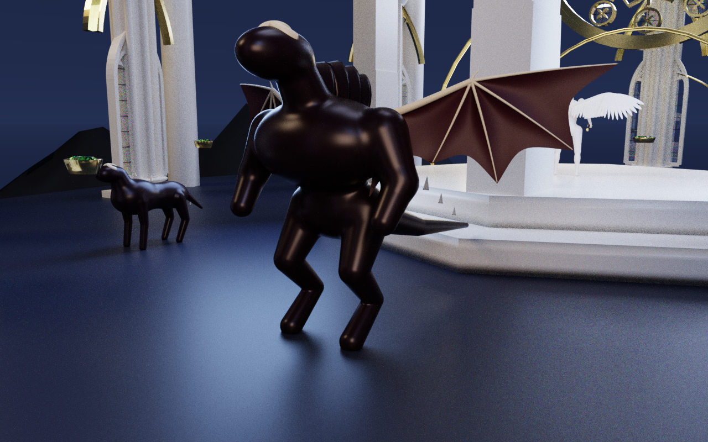
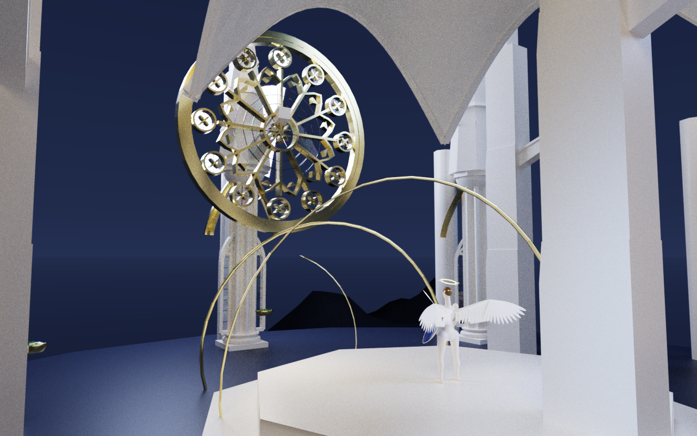

# Atelier V (`atelier 5.0`, `.a5`) — Architecture & Portfolio Showcase

**Atelier V** is a deterministic, embarrassingly parallel procedural 3D solid modeling, character/creature authoring, architectural level design, and **CUDA GPU path-tracing (`ffrt_lumiere`)** system, controlled via the `.a5` functional pipeline language and a companion Python SDK (`atelier5`).

> **Repository Status:** The core C++20/CUDA engine implementation is maintained in a private repository (`efeyener0/atelier5` and `domains/atelier` inside `the-meridian-monorepo`). This showcase documents the complete compiler/evaluator architecture, mathematical geometry spectrum, and the full 370-line `.a5` source script and 256-SPP CUDA renders for the *Museum of Seven Heavens* benchmark scene.

---

## 1. Portfolio Showcase: *Museum of Seven Heavens on Mountain of Kailash*

Generated 100% procedurally from a single 370-line `.a5` script ([`samples/museum_of_seven_heavens_kailash.a5`](samples/museum_of_seven_heavens_kailash.a5)) spanning **all 11 domain libraries** and **7 standard library geometry modules**, compiled into a **139-node SHA-256 Merkle DAG (`max_depth = 3`)** and rendered with the built-in CUDA GPU path-tracer (`ffrt_lumiere`, 256 SPP, ACES Filmic tone mapping).


### Multi-Camera Portfolio Views (`1280×800`, 256 SPP CUDA Path-Traced)

| **1. Kailash Summit Sanctuary — Overview** | **2. Seraph Guardian of the Seventh Heaven** |
| :---: | :---: |
|  |  |
| Stratified obsidian heightfield terrain (`map::terrain`), $14\text{ m}$ sacred court, $18\text{ m}$ golden Axis Mundi spire, 6 octagonal gothic spires, and East/West exhibition halls. | Articulated humanoid (`character::human`), feathered wings (`appendage::wing`), longsword (`weapon::longsword`), heater shield (`weapon::heater_shield`), halo (`appendage::halo`), and circlet (`jewelry::circlet`). |
| **3. Obsidian Draconic Gatekeeper & Sentinels** | **4. Colonnade of the Seven Heavens & Rose Window** |
|  |  |
| Bipedal draconic guardian (`creature::monster`) with dorsal chitinous carapace (`creature::carapace_plate`) and membrane wings (`appendage::wing`), flanked by quadruped sentinels (`creature::monster`). | Pointed gothic arches (`gothic::pointed`), flying buttresses (`gothic::flying_buttress`), golden rose window (`gothic::rose_window`), and spiral ascension helix (`std::curve::helix` `->` `std::sweep::pipe`). |

### Scene Telemetry

| Metric | Value |
| :--- | :--- |
| **Source Program** | [`samples/museum_of_seven_heavens_kailash.a5`](samples/museum_of_seven_heavens_kailash.a5) (`370` lines) |
| **Merkle DAG Topology** | `139` content-addressed nodes across `3` parallel wavefront depths |
| **Synthesized Geometry** | `271` meshes \| `486,613` vertices \| `798,372` triangles |
| **PBR Materials** | `19` procedural materials (obsidian, celestial marble, sacred gold, lapis lazuli, steel, chitin) |
| **Domains Exercised** | `map`, `gothic`, `character`, `creature`, `weapon`, `jewelry`, `garment`, `groom`, `appendage`, `body`, `mat` |

---

## 2. System Architecture

### 2.1. `.a5` Functional Pipeline Language & Dimensional Type Algebra
The `.a5` DSL treats curves, 2D profiles, 3D manifold meshes, signed distance fields (SDFs), and $SE(3)$ attachment sockets as immutable values transformed through functional pipeline operators (`->`, `==>`, `|>`):

```a5
piece ascension_helix = std::curve::helix(3.2m, 3.2m, 5.2m, turns = 2.0, samples = 96)
  -> std::sweep::pipe(helix_ribbon_prof, twist = 180deg, material = sacred_gold, name = "ascension_helix")
  -> std::deform::taper(z0 = 0.0, z1 = 5.2, scale0 = 1.0, scale1 = 0.8)
```

At the SDK level, physical units (`m`, `cm`, `mm`, `deg`, `rad`) map to compile-time dimension-checked types (`a5::Quantity<L, A, T>`), preventing unit mismatch errors between architectural (`m`) and jewelry/anatomical (`mm`) domains.

### 2.2. Content-Addressed SHA-256 Binary Merkle DAG & Wavefront Evaluator
Every `.a5` expression lowers into a canonical **Binary Merkle DAG** where each node's digest is a cryptographic **SHA-256** hash of its operator opcode, typed scalar/vector literals, and ordered child node hashes:
- **Deterministic Memoization & Cook Cache:** Identical sub-expressions across characters, architectural columns, or symmetry pairs collapse to a single DAG node and share cached geometry.
- **Embarrassingly Parallel Wavefront Execution:** Because nodes have zero mutable shared state, `a5::eval::Evaluator` partitions the DAG into topological wavefronts (`depth = 0, 1, ..., max_depth`) and executes all nodes within each wavefront concurrently across a work-stealing thread pool.

### 2.3. Multi-Method CSG & Geometry Processing Spectrum
Rather than relying on a single fragile Boolean algorithm, Atelier V implements a four-tier CSG spectrum selectable per operation (`BoolMethod`):
1. **`ExactBsp`:** Exact binary space partitioning for crisp planar/architectural polyhedra.
2. **`Arrangements`:** BVH-accelerated mesh intersection coupled with **Generalized Fast Winding Numbers** for robust inside/outside classification on complex curved meshes.
3. **`DualContour`:** Hermite grid **Quadratic Error Function (QEF)** solver with 2D saddle-face topological repair, preserving sharp creases while guaranteeing manifold output.
4. **`SdfBlend`:** Smooth $C^1$ polynomial/exponential signed-distance blending for organic transitions, musculature, and Wulff crystallographic growth.

### 2.4. Python SDK (`atelier5`) & C ABI (`a4.h`)
Atelier V exposes both a stable C ABI (`a4.h`) and a Python binding package (`atelier5`) for headless compilation, DAG inspection, `.glb` export, and automated batch rendering:

```python
import atelier5 as a5

res = a5.compile_file("samples/museum_of_seven_heavens_kailash.a5")
part = a5.eval_part(res.graph_json, "museum_of_seven_heavens_kailash")
a5.export_glb(res.graph_json, "museum_of_seven_heavens_kailash", "kailash.glb")
```
